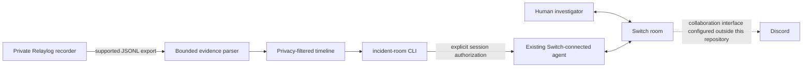

# Relaylog Incident Room

**Resolve incidents together. Keep the evidence.**

Relaylog Incident Room is an AI-assisted incident-response workflow connecting
structured terminal evidence with collaborative agents through Switch. This
repository is a standalone Rust workspace; the proprietary Relaylog recorder
and server are not included.

## Problem

Production investigations are split across terminals, logs, and team
conversations. Important command metadata and the reasoning around it can be
hard to review together after the incident.

## Solution

Relaylog exports a completed session as JSONL. This repository reads that
supported export, validates its structure and order, reports capture loss,
applies an explicit sharing boundary, and prepares structured evidence for an
agent. Switch gives the human and an existing coding agent a shared room to
discuss the evidence and draft a runbook.

The local demo is deterministic and uses fictional records. It does not call an
LLM or upload evidence.

## Architecture



The public workspace consumes only the supported JSONL export. It has no Cargo
path or Git dependency on Relaylog and never reads the encrypted spool. The
outer capture export remains unversioned; the verified agent payload inside
`record.type = "agent"` uses schema version 1. Agent events carry Relaylog
session IDs, event IDs, source observation times, actor/provider attribution,
correlation IDs, reported commands, outcomes, file paths, and coverage status.
Legacy shell records remain supported and retain unknown actor attribution.
Current shell-hook actor/source metadata is preserved when present, including
an explicit unknown actor. The serialized timeline reports a conservative
capture assessment: positive loss or partial-coverage signals are
`known_incomplete`; an export without a detected gap remains `unverified`,
because a clear footer is not a completeness attestation. Spool offsets are
export-local references, not globally unique event IDs. This repository does
not implement a Switch or Discord client.

## Agent-Aware Evidence Compatibility

`incident-room inspect --jsonl <file> --authorize-sharing` returns a bounded
JSON evidence bundle with a unified human/agent timeline. `incident-room query`
provides a read-only, authorization-gated timeline, event, provider, failure,
and file-operation query for an existing Switch-connected coding agent to run.
No MCP server or separate Discord bot is added. Unknown event variants and
unsupported agent payload versions remain reference-only. Capture loss,
partial provider coverage, and duplicate/conflicting event IDs remain visible.

The parser follows the Relaylog core's versioned provider-neutral agent payload
v1 nested in the existing capture JSONL wrapper. The checked core currently
contains a Codex adapter; Claude Code and Gemini CLI payloads are not claimed as
recorded until their adapters emit this same normalized contract. The fixture
is synthetic and authored against the verified serialization shape; validating
it against a freshly exported file from the updated private binary remains an
end-to-end compatibility task. The separate versioned terminal control-frame
fixture is not treated as a JSONL export.

## Quick Start

Requires Rust 1.85 or newer.

```bash
cargo build --workspace
```

Run the synthetic incident draft:

```bash
cargo run -p incident-room -- demo \
  --fixture examples/api-incident/synthetic-session.jsonl
```

To include the synthetic command metadata in the local draft, explicitly opt
in:

```bash
cargo run -p incident-room -- demo \
  --fixture examples/api-incident/synthetic-session.jsonl \
  --authorize-sharing
```

Inspect an exported JSONL file. By default, this prints a content-free summary.
Add `--authorize-sharing` to prepare a structured bundle of approved metadata
for an agent. The command does not send the bundle anywhere.

```bash
cargo run -p incident-room -- inspect --jsonl /path/to/session.jsonl
cargo run -p incident-room -- inspect --jsonl /path/to/session.jsonl --authorize-sharing
```

Query agent-attributed activity, a single event reference, reported failures,
or file operations. All detailed queries require explicit sharing approval and
return at most 500 records:

```bash
cargo run -p incident-room -- query --jsonl /path/to/session.jsonl \
  --agent-provider openai --authorize-sharing
cargo run -p incident-room -- query --jsonl /path/to/session.jsonl \
  --file-operations --authorize-sharing
cargo run -p incident-room -- query --jsonl /path/to/session.jsonl \
  --tool-invocation call_123 --offset 0 --limit 100 --authorize-sharing
cargo run -p incident-room -- query --jsonl /path/to/session-a.jsonl \
  --jsonl /path/to/session-b.jsonl --event session-2/offset-128 \
  --authorize-sharing
```

Repeated `--jsonl` inputs combine up to eight sessions for that query only.
References use temporary `session-N/offset-N` names in input order; this is not
a persisted Switch-room/session mapping.

For the optional Relaylog CLI path, the application invokes `relaylog export`
with separate process arguments and no shell. Sharing authorization is
required before the output bundle is prepared:

```bash
cargo run -p incident-room -- investigate \
  --session /path/to/session-directory \
  --authorize-sharing
```

If Relaylog is a local Cargo build and is not on `PATH`, pass its executable
explicitly:

```bash
cargo run -p incident-room -- investigate \
  --session /path/to/session-directory \
  --relaylog-bin /path/to/relaylog/target/debug/relaylog \
  --authorize-sharing
```

This prints a local bundle to stdout. It does not upload evidence to Switch or
another service. See [Switch setup](switch/README.md) before handing real
evidence to an agent.

If the Relaylog session requires an interactive passphrase, export it from the
operator's terminal to a protected temporary JSONL file and use `inspect`
instead. The Incident Room subprocess closes stdin and cannot receive a
passphrase through standard input.

## Codex Hook Shortcuts

Relaylog core owns Codex hook installation and recording. The Makefile here
only shortens CLI commands; it does not build or download the private recorder.
Install a Relaylog binary that supports Codex hooks, then set `RELAYLOG` to its
path if it is not on `PATH`:

```bash
make hooks-install RELAYLOG=/path/to/relaylog
make record RELAYLOG=/path/to/relaylog CAPTURE=metadata
# In the Relaylog shell, run:
codex
# In Codex, review and trust the Relaylog handlers with /hooks.
# From the Relaylog shell, check attachment with:
make status
```

When the recording ends, `make record` prints the session directory again so
you can pass it to `make export` without having to find it in startup output.

`HOOK_SCOPE=user` is the default. Set `HOOK_SCOPE=project` while in the target
project to install project-scoped hooks. `CAPTURE=metadata` is the default;
Relaylog core also supports `commands` and `file-paths` capture levels. For an
explicitly attached Codex process or to export a completed session:

```bash
make attach RELAYLOG=/path/to/relaylog SESSION_DIR=/path/to/active-session
make export RELAYLOG=/path/to/relaylog SESSION_DIR=/path/to/session OUT=session.jsonl
make investigate RELAYLOG=/path/to/relaylog SESSION_DIR=/path/to/session AUTHORIZE_SHARING=yes
make hooks-uninstall RELAYLOG=/path/to/relaylog
```

## Switch Workflow

The intended workflow uses a coding agent already supported by Switch Console.
The agent runs `incident-room` from this repository after the human approves a
specific session. It can invoke the CLI as a normal read-only local tool; this
repository has no MCP service, room API client, Discord handler, or persistent
room/session mapping. Setup and the agent's operating instructions are in
[`switch/README.md`](switch/README.md) and
[`switch/agents/incident-investigator.md`](switch/agents/incident-investigator.md).

The repository does **not** claim a live Switch room was connected or tested in
this scaffold. Follow the setup and verify an agent reply in your own Switch
room before describing the workflow as a completed integration.

## Security and Privacy

- The main Relaylog recorder and server are proprietary and are not included.
- JSONL records are untrusted input. Parsing is bounded, validates the final
  capture-gap summary, and rejects malformed or missing-summary exports. A
  valid export reporting dropped records or truncation is labeled incomplete.
- Private-mode intervals and their markers are omitted. Inconsistent or
  unclosed intervals fail closed.
- Terminal input is never shared. Terminal output is omitted unless the
  separate `--include-terminal-output` option is used with
  `--authorize-sharing`; output and total bundle sizes are capped.
- Command text, working directories, origin fields, and output bytes can still
  contain sensitive information. Explicit approval is not a secret scanner and
  does not guarantee complete secret filtering.
- Evidence values are labeled untrusted data and are never executed by this
  application. Prompt-injection resistance also depends on the connected
  agent's instructions and tool permissions; it is not a guarantee about model
  behavior.
- Nothing is sent externally by this repository. If a Switch-connected agent
  invokes the CLI, its approved output becomes available to that agent.

Read [the security notes](docs/security.md) before using real sessions.

## Hackathon

This workflow is designed for the Flip the Switch Hackathon: a person and an AI
agent collaborate in a Switch room to investigate a real task. Switch supports
existing agents and a custom agent protocol. This scaffold chooses the existing
coding-agent path and leaves live room verification as a setup task. Official
resources: [hackathon overview](https://www.wemakedevs.org/hackathons/switch),
[Switch documentation](https://docs.switchagents.ai/), and [agent
protocol](https://docs.switchagents.ai/switch-rooms/internals/agent-protocol).

## Licensing

No license has been selected. The root `LICENSE` file is a status note, not a
license grant. See [the licensing decision note](docs/licensing-decision.md).

## Development

```bash
cargo fmt --all --check
cargo check --workspace
cargo test --workspace
cargo clippy --workspace --all-targets -- -D warnings
```
