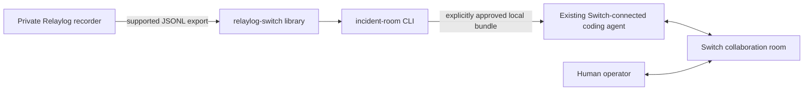

# Architecture

## Trust boundary

The public workspace is an independent Cargo workspace. Its only Relaylog
integration is the supported `relaylog export <session-directory>` process
interface or a JSONL file supplied by the operator. It never opens the private
FIFO, encrypted spool, key files, or Relaylog's Cargo workspace.

## Export model

The export contains ordered records with `spool_offset` and a nested `record`,
followed by one final `capture_gaps` object. Known capture record types are
`input`, `output`, `shell`, `origin`, and `redaction`. Terminal byte streams are
byte arrays. Shell event payloads are preserved as opaque JSON because their
nested fields can vary. The final summary includes queue and capacity loss
counters and an optional truncation offset.

The export does not contain a session identifier or wall-clock timestamps.
References formatted as `offset-N` are only meaningful within that export.
The reader preserves export order and does not sort records.

## Evidence and reports

Parsed records retain their provenance as observed, operator-reported, or
unknown. The library also reserves an AI-generated category for later report
workflows; the parser never labels Relaylog records as AI findings. The demo
creates a draft report with observations, hypotheses, recovery actions,
validation, unresolved questions, and human review status. The fixture's
database-pool hypothesis is synthetic scenario context, not a verified
conclusion.

## Switch choice

The current minimum path is an existing coding agent managed by Switch Console,
configured with this repository as its working directory. The agent can run
the local CLI after the operator authorizes sharing. A custom protocol client
is unnecessary for this workflow and is not implemented here. See
[`integration.md`](integration.md) for the setup and current verification state.
