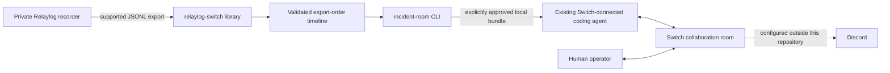

# Architecture

## Trust boundary

The public workspace is an independent Cargo workspace. Its only Relaylog
integration is the supported `relaylog export <session-directory>` process
interface or a JSONL file supplied by the operator. It never opens the private
FIFO, encrypted spool, key files, or Relaylog's Cargo workspace.

## Export model

The supported JSONL wrapper contains ordered records with `spool_offset` and a
nested capture `record`, followed by one final `capture_gaps` object. Legacy
capture records (`input`, `output`, `shell`, `origin`, and `redaction`) remain
supported. Agent records use the wrapper shape
`{"type":"agent","session_id":"…","evidence":{…}}`; the nested payload
is versioned independently and currently supports schema version 1.

The v1 agent payload carries event ID/type, source observation timestamp,
actor identity/type/provider, source and coverage classifications, provider
session and tool correlation IDs, optional command/tool/result/duration data,
file paths, and bounded detail. It does not carry a global event sequence.
Relaylog spool offsets determine exported order; source timestamps are not
used to sort concurrent operations. A missing completion stays missing, and a
completion boundary is not interpreted as success. Provider-reported failures
remain reports. Event IDs are idempotency keys: identical duplicates are
marked, while conflicting payloads become reference-only unknown events.

One export cannot contain multiple Relaylog recording session IDs. Provider
session IDs and Switch/Discord room IDs are distinct namespaces and are never
treated as interchangeable. `offset-N` references are local to a specific
export. Nonzero capture-gap counters and provider coverage values remain
visible; absence from an incomplete timeline does not establish that an event
did not happen.

## Evidence and reports

Records retain observed, operator-reported, agent-reported, imported, and
unknown provenance. Shell events have unknown human/agent actor attribution;
agent v1 events use the producer's actor metadata. Agent hook events are not
independent OS verification. Unknown variants are represented by an evidence
reference and no payload. Timeline APIs query by evidence reference, provider,
failed operation, and file-operation event. `incident-room query` exposes the
same read-only projection with explicit consent and bounded results.

The deterministic report is a draft, cites source references, separates
reported activity from verified shell exit statuses, reports file paths only
when a file hook supplied them, and does not generate a diagnosis. The fixture's
database-pool hypothesis is synthetic scenario context, not a verified
conclusion. Human approval is not inferred from an agent approval event or
from absence of a human event.

Relaylog's known `unstructured` shell marker is exposed as a capture limitation
without its raw reason string. Loss counters and this marker are distinct: a
zero dropped-record count does not make an unstructured command hook complete.

## Switch choice

The current minimum path is an existing coding agent managed by Switch Console,
configured with this repository as its working directory. The agent can run
the local CLI after the operator authorizes sharing. This repository has no
MCP server, Discord handler, session-mapping store, or Switch protocol client.
It cannot attach a Switch-managed agent to a Relaylog session. See
[`integration.md`](integration.md) for the setup and current verification state.

## Agent-event compatibility status

The parser implements the core's provider-neutral agent payload v1 as it appears
inside the current JSONL `CaptureRecord::Agent` wrapper. Unsupported schema
versions and unknown normalized event types are retained only by reference.
The checked core currently provides a Codex adapter; Claude Code and Gemini CLI
are supported by the normalized architecture but their core adapters are not
present in the checked tree. The public synthetic fixture mirrors the verified
wrapper and payload shape but has not been produced by the private Relaylog
binary. Confirm a fresh export from the updated core before claiming end-to-end
binary compatibility.

## Integration boundaries

This repository currently has no MCP server, Discord handler, Switch API
client, persistent room/session mapping, or live-event subscriber. A
Switch-connected coding agent can invoke the local CLI as a read-only tool
after the human approves one session. Post-session JSONL remains primary.
Switch-managed agents are not automatically attached to Relaylog sessions; a
future secure association must be explicit and supported by Relaylog core.
